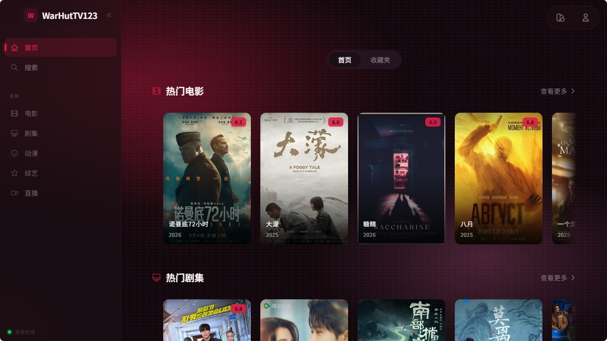
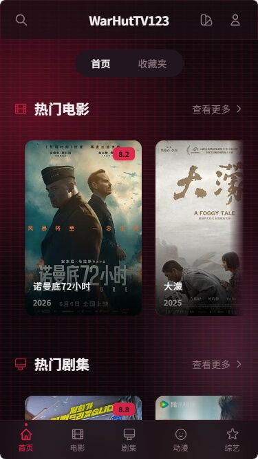

<p align="center">
  
</p>

<h1 align="center">WarHutTV</h1>

<p align="center">
  自托管影视聚合播放器 · 跨源搜索 · 在线点播
</p>

<p align="center">
  
  
  
  
  
  
</p>

---

## 📖 项目简介

WarHutTV 是一个自托管的媒体聚合播放器，从多个第三方视频源聚合影视内容，提供统一的搜索、浏览和播放体验。

- **搜索即所得** — 同时搜索多个资源站，SSE 流式实时返回结果
- **聚合去重** — 按标题和年份自动合并不同来源的同一影片
- **智能优选** — 自动测速所有可播放源，选择最流畅的线路
- **沉浸观看** — 基于 HLS.js + Artplayer，支持倍速、画中画、广告过滤
- **全端覆盖** — PWA 支持，移动端底部导航 + 桌面端侧边栏

---

## ✨ 功能特性

### 🔍 跨源聚合搜索

- SSE 流式搜索，同时查询所有已配置的资源站
- 实时进度展示，每个源返回结果即显示
- 搜索结果按标题和年份智能聚合去重

### ▶️ 在线播放

- Artplayer 播放器，支持 HLS（.m3u8）流媒体
- 多播放线路切换 + 自动测速优选
- 倍速播放、画中画、进度拖拽
- 广告拦截（内置规则过滤）

### 🎬 影视发现

- 豆瓣热门推荐：电影、电视剧、综艺、动漫分类浏览
- Bangumi 番组日历：每日放送列表，星期筛选

### 🎨 多主题系统

6 套深色视觉主题，每套包含独特的纹理、光晕动画和卡片风格：

| 主题 | 风格特点 |
|------|----------|
| 🔴 绯红影院 | 热力红，动感光晕 |
| 🟡 影院金 | 金色质感，奢华纹理 |
| 🟣 星云紫 | 紫色星云，柔和渐变 |
| 🟢 翡翠夜 | 墨绿翡翠，沉稳低调 |
| 🔵 极地冰 | 冰蓝冷色，干净利落 |
| 🌹 玫瑰绒 | 粉紫暖色，绒面质感 |

### 📦 本地存储（IndexedDB）

| 存储内容 | 说明 | TTL |
|---------|------|-----|
| 💛 收藏夹 | 影片收藏，永久保存 | — |
| 📜 播放历史 | 自动记录进度，支持续播 | — |
| ⚡ API 缓存 | 搜索结果、详情、配置 | 2h ~ 7d |
| 📅 Bangumi 日历 | 番组放送表 | 24h |

### 🔧 其他

- **PWA 支持** — Service Worker 离线缓存，可添加到桌面
- **密码保护** — JWT 认证，保护非公开 API
- **速率限制** — 基于 IP 的请求频率控制
- **响应式布局** — 桌面端侧边栏、移动端底部导航栏
- **快捷部署** — Docker 一键启动，支持 Docker Compose

---

## 🏗️ 技术架构

```
┌──────────────────────────────────────────────────┐
│                   前端 (React + Vite)             │
│  ┌────────┐ ┌──────────┐ ┌───────────────────┐   │
│  │ 页面层  │ │  组件层   │ │  状态层            │   │
│  │ 6 路由   │ │ Layout   │ │ AuthContext       │   │
│  │ 鉴权    │ │ Player   │ │ ConfigContext     │   │
│  │ 懒加载   │ │ VideoCard│ │ IndexedDB(Dexie)  │   │
│  └────┬───┘ └────┬─────┘ └────────┬──────────┘   │
│       └──────────┼────────────────┘              │
│                  ▼                                │
│          ┌──────────────┐                        │
│          │  API 客户端   │  Axios + SSE          │
│          └──────┬───────┘                        │
└─────────────────┼────────────────────────────────┘
                  │  /api/*
┌─────────────────┼────────────────────────────────┐
│                 ▼                                 │
│         后端 (Go + Gin)                            │
│  ┌────────┐ ┌──────────┐ ┌────────────────────┐  │
│  │ 中间件  │ │ 处理器    │ │  服务层             │  │
│  │ CORS   │ │ search   │ │  源站代理 + SSRF 防护│  │
│  │ JWT    │ │ detail   │ │  磁盘缓存 + 清理    │  │
│  │ 限流   │ │ play     │ │  m3u8 解析          │  │
│  │ 日志   │ │ douban   │ │                    │  │
│  │        │ │ bangumi  │ │                    │  │
│  │        │ │ sites    │ │                    │  │
│  └────────┘ └──────────┘ └────────────────────┘  │
│                                                   │
│  ┌──────────────┐  ┌─────────────────────┐        │
│  │ 配置层 env   │  │ 第三方视频源 API    │        │
│  │ + config.json│  │ 豆瓣 / Bangumi     │        │
│  └──────────────┘  └─────────────────────┘        │
└───────────────────────────────────────────────────┘
```

### 数据流

```
用户搜索 → 前端 SSE → 后端并发请求各视频源 → 标准化返回
              ↓
        前端聚合去重 → 展示结果
              ↓
        用户点击 → 获取详情 → 解析播放地址
              ↓
        多源测速优选 → 播放
```

---

## 🚀 快速开始

### 环境要求

- **Go** 1.26（与 `backend/go.mod`、CI、Dockerfile 保持一致）
- **Node.js** 20+ & **pnpm** 10+（仅开发需要）

### 开发模式

```bash
# 克隆项目
git clone https://github.com/OuOumm/WarHutTV.git
cd WarHutTV

# 1. 配置密码（二选一）
#    a) 环境变量：PASSWORD=dev-pass JWT_SECRET=$(openssl rand -hex 32) make run
#    b) 复制示例并修改：cp data/config.example.json data/config.json
#       至少把 password 改掉（程序拒绝以 admin123 启动）

# 2. 启动后端（默认 :3000，读取仓库根目录的 data/config.json）
make run
# 等价于：cd backend && go run . -config ../data/config.json

# 3. 新终端，启动前端（Vite dev server :5173）
cd frontend && pnpm install && pnpm run dev
```

浏览器打开 `http://localhost:5173`，输入配置的密码即可登录。

### 生产构建

```bash
make build    # 构建前端 + 后端，输出到 bin/
make run      # 直接运行（需先构建）
```

跨平台构建：

```bash
# Linux / macOS
chmod +x build.sh && ./build.sh

# Windows PowerShell
powershell -ExecutionPolicy Bypass -File build.ps1
```

构建产物：

```
bin/
├── warhutv-linux-amd64
├── warhutv-linux-arm64
├── warhutv-windows-amd64.exe
├── warhutv-darwin-amd64
└── warhutv-darwin-arm64
```

---

## 🐳 Docker 部署

### 使用预构建镜像

```bash
docker pull ghcr.io/OuOumm/warhutv:latest
docker run -d \
  --name warhutv \
  -p 3000:3000 \
  -e PASSWORD=your_password \
  -e JWT_SECRET=your_secret \
  -v warhutv-data:/app/data \
  ghcr.io/OuOumm/warhutv:latest
```

- `PASSWORD` 必填；未设置 `JWT_SECRET` 时程序会自动生成并保存到 `/app/data/config.json`。
- 配置与缓存都写在 `/app/data`，挂载该目录即可持久化；也可以直接把宿主机配置挂进去：
  `-v "$PWD/data:/app/data"`。
- 镜像以非 root 用户（uid 10001）运行，自带 `HEALTHCHECK`（探测 `/api/healthz`，跟随 `PORT` 变化）。

### 本地构建运行

```bash
docker build -t warhutv .
docker run -d --name warhutv -p 3000:3000 -e PASSWORD=your_password -v warhutv-data:/app/data warhutv
```

### Docker Compose

```yaml
services:
  warhutv:
    build: .
    ports:
      - "3000:3000"
    environment:
      - PASSWORD=your_password
      - JWT_SECRET=your_secret
    volumes:
      - warhutv-data:/app/data
    restart: unless-stopped

volumes:
  warhutv-data:
```

---

## ⚙️ 配置

### 配置优先级

**环境变量 > `data/config.json` > 内置默认值**

`PASSWORD` / `JWT_SECRET` 来自环境变量时只存在于内存中，不会被写入 `data/config.json`（首次启动自动生成的 `jwt_secret` 例外）。

### 环境变量

| 变量 | 说明 | 默认值 |
|------|------|--------|
| `PORT` | HTTP 监听端口 | `3000` |
| `PASSWORD` | 登录密码（必填，或写在 config.json） | — |
| `JWT_SECRET` | JWT 签名密钥（留空自动生成并持久化） | — |
| `SITE_NAME` | 站点名称，覆盖 `site_name` | — |
| `WARHUTV_CONFIG` | 配置文件路径 | `data/config.json` |
| `TRUSTED_PROXIES` | 信任的反向代理 IP/CIDR（逗号分隔），用于正确解析客户端 IP | `127.0.0.1,::1` |
| `SEARCH_SITE_TIMEOUT` | 单个搜索源的超时预算（秒数或 Go 时长，如 `10`、`2500ms`）；超时或失败的源被丢弃并计入进度，避免卡在 `24/27`。范围 `0.5s`–`20s`。默认 10s 兼顾慢但可用的源（部分源需 4–6s） | `10s` |
| `CONFIG_WATCH_INTERVAL` | 配置文件热重载的轮询间隔（秒数或 Go 时长，如 `2`、`500ms`）；范围 `200ms`–`5m`。设为 `0`/`off`/`false` 关闭轮询（仅保留 SIGHUP） | `2s` |

> ⚠️ 生产环境请务必设置 `PASSWORD`，并使用强随机 `JWT_SECRET`。程序拒绝以 `admin123` 或默认 secret 启动。

### 热重载

编辑 `data/config.json`（`api_site`、`site_name`、`announcement`、`password`、`jwt_secret`）后**无需重启**：

- **轮询**：后台默认每 2s 检测文件内容变化（按内容 hash，不是 mtime），变化即重新加载；用 `CONFIG_WATCH_INTERVAL` 调整频率，`0`/`off`/`false` 可关闭。
- **信号**：Linux / macOS 上发送 `SIGHUP` 立即重载：`kill -HUP $(pgrep warhutv)`（Windows 无 SIGHUP，走轮询即可）。

安全约束：坏文件（JSON 解析失败、缺文件、`password`/`jwt_secret` 为空或仍是默认值）会被**拒绝并保持旧配置**，日志记一条错误；重载**不会**重新生成 `jwt_secret`（避免让所有在线会话失效），也不会写回文件。环境变量优先级仍高于文件，因此 `PASSWORD`/`JWT_SECRET` 若在环境变量里设置，改文件不会生效——这类改动仍需重启。

### data/config.json

```json
{
  "site_name": "WarHutTV",
  "announcement": "欢迎使用 WarHutTV",
  "password": "your_password",
  "jwt_secret": "your_secret",
  "api_site": {
    "source_1": {
      "api": "http://example.com/api.php/provide/vod",
      "name": "资源站 1"
    },
    "source_2": {
      "api": "http://example2.com/api.php/provide/vod",
      "name": "资源站 2"
    }
  }
}
```

| 字段 | 说明 | 必填 |
|------|------|------|
| `site_name` | 站点名称（显示在页面标题） | 否 |
| `announcement` | 站点公告（启动时弹窗显示） | 否 |
| `password` | 登录密码 | 若未设环境变量则必填 |
| `jwt_secret` | JWT 签名密钥 | 若未设环境变量则必填 |
| `api_site` | 视频源配置，key 为自定义标识 | 是 |

---

## 🛠️ 开发指南

### 项目结构

```
WarHutTV/
├── backend/                  # Go 后端
│   ├── main.go               # 入口 + 路由注册
│   ├── static_*.go           # 前端静态资源（embed / 本地目录两种构建）
│   ├── config/               # 配置加载（环境变量 + JSON）
│   ├── handlers/             # HTTP 处理器
│   │   ├── auth.go           #   登录 / 登出
│   │   ├── search.go         #   跨源搜索（SSE）
│   │   ├── detail.go         #   视频详情
│   │   ├── play.go           #   按集解析播放地址
│   │   ├── douban.go         #   豆瓣代理（服务端转发）
│   │   ├── bangumi.go        #   Bangumi 番组日历
│   │   ├── sites.go          #   播放源可用性探测
│   │   ├── config.go         #   站点配置
│   │   ├── health.go         #   健康检查
│   │   └── version.go        #   版本信息
│   ├── middleware/            # Gin 中间件
│   │   ├── auth.go           #   JWT 认证
│   │   ├── cors.go           #   跨域
│   │   ├── logging.go        #   请求 ID + 结构化访问日志
│   │   ├── security.go       #   安全响应头 / CSP
│   │   └── ratelimit.go      #   速率限制
│   ├── services/              # 业务逻辑层
│   │   ├── proxy.go          #   源站代理（含 SSRF 防护、m3u8 解析）
│   │   └── cache.go          #   磁盘缓存 + 定期清理
│   └── utils/                 # 工具
│       └── jwt.go            #   JWT 令牌
│
├── frontend/                 # React 前端
│   ├── src/
│   │   ├── api/              # API 客户端
│   │   │   ├── client.ts     #   Axios 实例 + 拦截器
│   │   │   ├── auth.ts       #   登录登出
│   │   │   ├── config.ts     #   站点配置读取
│   │   │   ├── searchStream.ts #  搜索结果 SSE 解析
│   │   │   ├── douban.ts     #   豆瓣（经后端代理）
│   │   │   └── bangumi.ts    #   Bangumi
│   │   ├── components/        # 可复用组件
│   │   ├── pages/             # 页面组件（6 条路由）
│   │   ├── store/             # 状态管理
│   │   │   ├── auth.tsx      #   AuthContext
│   │   │   ├── config.tsx    #   ConfigContext
│   │   │   ├── configCache.ts#   配置模块级缓存
│   │   │   ├── theme.ts      #   6 套主题定义
│   │   │   ├── db.ts         #   Dexie.js 数据库
│   │   │   ├── favorites.ts  #   收藏 CRUD
│   │   │   ├── history.ts    #   历史 CRUD
│   │   │   ├── apiCache.ts   #   API 缓存
│   │   │   └── detailCache.ts#   详情缓存
│   │   ├── hooks/             # 自定义 Hooks
│   │   ├── utils/             # 工具函数
│   │   │   ├── filter.ts     #   搜索结果聚合
│   │   │   ├── speedtest.ts  #   播放源测速
│   │   │   ├── adblock.ts    #   广告过滤规则
│   │   │   └── image.ts      #   图片代理
│   │   └── types/             # TypeScript 类型
│   ├── public/                # PWA 资源（sw.js、图标、占位图）
│   └── ...config files
│
├── data/
│   └── config.json            # 运行时配置（gitignored）
├── bin/                        # 编译产物
├── docs/                       # 设计/评审文档
├── .github/workflows/          # CI/CD
├── Dockerfile                  # 开发镜像
├── Dockerfile.release          # 发布镜像
├── Makefile
├── build.sh / build.ps1
└── version                     # 版本文件
```

### 常用命令

```bash
make dev              # 启动前端开发服务器
make build            # 完整构建（前端 + 后端）
make run              # 运行后端（默认读 ./data/config.json）
make test             # 全部检查：lint + 单测 + tsc + gofmt + go vet + go test
make lint             # 仅静态检查
make clean            # 清理产物
make docker           # 构建 Docker 镜像（自动注入版本号）
```

### 接口一览

| 方法 | 路径 | 鉴权 | 说明 |
|------|------|------|------|
| GET | `/api/version` | 否 | 版本号（来自 `version` 文件或构建注入） |
| GET | `/api/healthz` | 否 | 健康检查，容器 `HEALTHCHECK` 使用 |
| POST | `/api/auth/login` | 否 | 登录；失败计入限流，成功重置计数 |
| POST | `/api/auth/logout` | 否 | 清除认证 Cookie |
| GET | `/api/config` | 视情况 | 未登录只返回站点名/公告；登录后附带 `api_site` |
| GET | `/api/search/stream` | 是 | SSE 跨源搜索（`wd`、`pg`），含 15s 心跳 |
| GET | `/api/detail` | 是 | 详情（`site`、`ids`），附带解析好的 `episodes` |
| GET | `/api/play` | 是 | 按集取播放地址（`site`、`ids`、`episode`） |
| GET | `/api/sites/ping` | 是 | 播放源可用性探测（真实 RTT + 结果条数） |
| GET | `/api/bangumi/calendar` | 是 | 番组日历，直连失败自动回退镜像 |
| GET | `/api/douban/*path` | 是 | 豆瓣数据代理（路径白名单） |
| GET | `/api/auth/verify` | 是 | 校验当前 Cookie 是否有效 |

> 未匹配的 `/api/*` 一律返回 `404 {"error":"接口不存在"}`，不会被 SPA 兜底成 HTML。

### 添加新页面 / API

- **新页面**：在 `frontend/src/pages/` 创建组件 → 在 `App.tsx` 注册路由
- **新后端 API**：在 `backend/handlers/` 添加 handler → `main.go` 注册路由 → `frontend/src/api/` 添加客户端
- **新主题**：在 `frontend/src/store/theme.ts` 中添加主题定义
- **新视频源**：在 `data/config.json` 的 `api_site` 中添加

---

## 📦 GitHub Actions CI/CD

| Workflow | 触发条件 | 功能 |
|----------|----------|------|
| **ci.yml** | Push / PR 到 `master` | 前端 lint + 单测 + 打包，后端 gofmt / vet / test / 编译，上传制品 |
| **release.yml** | 推送 `v*` 标签 | 多平台构建（5 平台）+ UPX 压缩 → GitHub Release + Docker 镜像推送 GHCR |

### 发布新版本

```bash
# 更新版本号
echo "1.1.0" > version

# 打标签推送
git add version && git commit -m "chore: bump version to 1.1.0"
git tag v1.1.0
git push origin v1.1.0
```

自动生成：
- 5 个平台二进制（.tar.gz / .zip）
- Docker 镜像 `ghcr.io/OuOumm/warhutv:latest` + `:v1.1.0`
- Release Notes 自动生成

---

## ❓ 常见问题

### 登录密码是什么？

必须在 `data/config.json` 的 `password` 字段设置密码，或者通过环境变量 `PASSWORD` 设置；两者都没有（或仍是示例文件里的 `admin123`）时程序**拒绝启动**并提示需要先完成配置。应用不提供在线改密入口，改密码请直接修改 `data/config.json` 的 `password` 字段（保存后 2s 内自动热重载生效，见「热重载」）；若密码来自 `PASSWORD` 环境变量，则需要重启服务才能变更。

### 如何添加视频源？

直接编辑 `data/config.json` 的 `api_site` 字段（应用不提供在线源管理入口）。格式要求兼容通用资源站 API（`/api.php/provide/vod` 接口），修改后自动热重载生效（默认 2s 内），无需重启。

### 支持哪些播放格式？

主要支持 `.m3u8`（HLS）流媒体格式，以及资源站直接返回的 mp4 直链。HLS 主播放列表会选最高码率变体，分片请求可由浏览器直连（上游禁止跨域时由前端 `adblock` 逻辑回退）。

### 豆瓣/Bangumi 数据是怎么请求的？

全部经后端代理（`/api/douban/*path`、`/api/bangumi/calendar`）：服务端设置 `User-Agent`/`Referer`、按白名单回退多个镜像、结果缓存 2h/12h。浏览器不再直连任何第三方镜像，也不需要为它们配置代理。

### 移动端体验如何？

支持 PWA 添加到桌面，移动端采用底部导航栏布局，适配小屏操作。

### 如何切换主题？

页面左下角主题切换按钮，提供 6 套预置深色主题可选。设置保存在浏览器 localStorage 中。

---

## 📸 截图预览

<details open>
<summary><b>🖥️ 桌面端</b></summary>
<br>
<p align="center">
  
</p>
</details>

<details>
<summary><b>📱 移动端</b></summary>
<br>
<p align="center">
  
</p>
</details>

---

## 🙏 致谢

- [LunaTV](https://github.com/MoonTechLab/LunaTV) — 项目灵感来源
- [Artplayer](https://github.com/zhw2590582/ArtPlayer) — 播放器
- [hls.js](https://github.com/video-dev/hls.js) — HLS 流播放
- [Dexie.js](https://github.com/dexie/Dexie.js) — IndexedDB 优雅封装
- [React](https://react.dev) + [Tailwind CSS](https://tailwindcss.com) — 前端框架
- [Gin](https://github.com/gin-gonic/gin) — Go HTTP 框架
- [Vite](https://vitejs.dev) — 构建工具

---

## 📄 License

[CC BY-NC-SA 4.0](LICENSE) — **非商业使用，二改必须开源**

- **NonCommercial** — 不得以商业盈利为目的使用
- **ShareAlike** — 任何修改、衍生作品必须以相同许可证发布
- **Attribution** — 必须保留原作者署名
